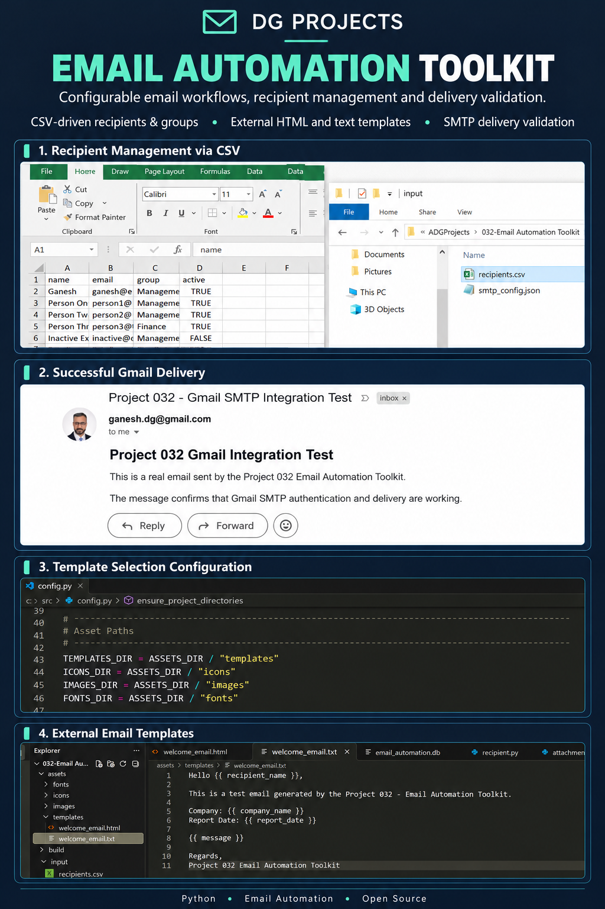
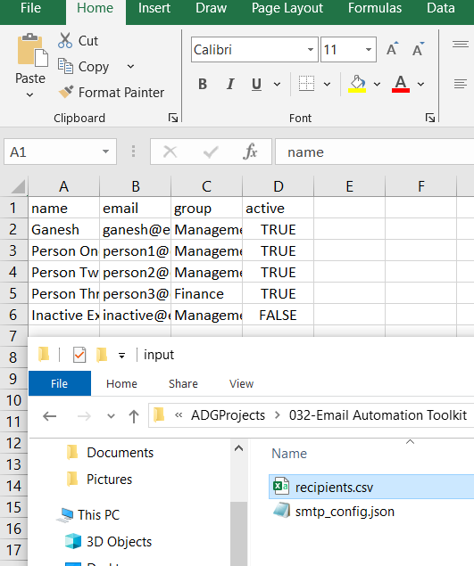
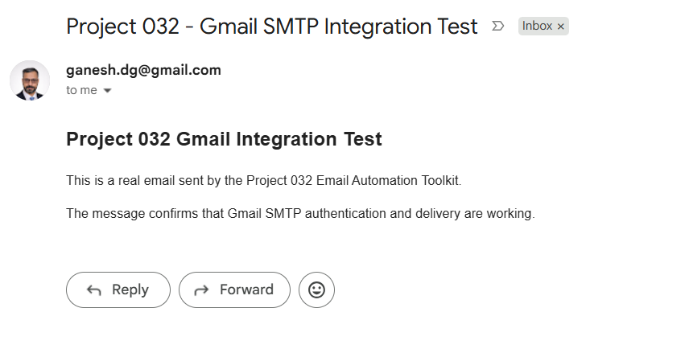
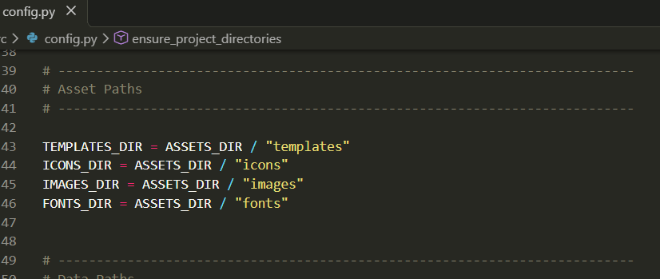
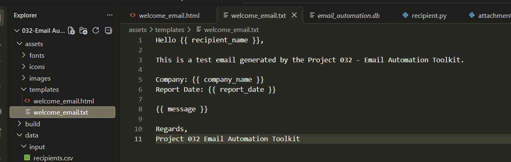

# 2. Project Badges


# 3. Screenshots

### Recipient Management via CSV



### Successful Gmail Delivery



### Template Path Configuration



### External Email Templates



# 4. Project Title — Project 032: Email Automation Toolkit

A Python-based toolkit for generating and delivering templated emails using configurable recipients, SMTP settings, and repeatable email workflows.

# 5. Project Overview

## Purpose

The Email Automation Toolkit provides a structured way to generate, validate, schedule, and deliver email messages from reusable HTML and plain-text templates.

## Problem Solved

Preparing recurring operational emails manually can be repetitive and error-prone. This project separates recipient data, templates, and SMTP configuration from application logic, making common email workflows easier to maintain.

## Typical Use Cases

- Sending operational or periodic reports to defined recipient groups.
- Generating personalized messages from reusable templates.
- Delivering one shared message to multiple recipients or separate messages to individual recipients.
- Validating email jobs and tracking delivery outcomes.
- Scheduling email jobs and recording execution results.

# 6. Features

- **External templates:** Uses paired HTML and plain-text templates stored in `assets/templates/`.
- **Template rendering:** Supports template variables through Jinja2.
- **CSV recipient management:** Loads recipients and group assignments from `data/input/recipients.csv`.
- **Recipient validation:** Validates required CSV columns and values, skips inactive rows, and rejects duplicate active email addresses.
- **Recipient groups:** Imports active recipients and resolves group membership.
- **SMTP configuration:** Loads SMTP settings from `data/input/smtp_config.json`.
- **Email construction:** Builds and validates email jobs and MIME messages.
- **Delivery modes:** Supports shared-recipient delivery and individual-recipient delivery paths.
- **Attachments:** Validates attachments before email job processing.
- **Persistence:** Uses SQLite to store application records and email jobs.
- **Scheduling:** Supports schedule creation, persistence, activation, deactivation, and scheduled execution.
- **Delivery tracking:** Records delivery history and supports retry-related workflows.
- **Execution reporting:** Produces an execution report under `logs/`.

## Recipient CSV Format

The recipient file is `data/input/recipients.csv`. It must contain these columns:

| Column | Purpose |
| --- | --- |
| `name` | Recipient display name |
| `email` | Recipient email address |
| `group` | Recipient group |
| `active` | Whether the row is active |

Supported values for `active` are `true`/`false`, `yes`/`no`, and `1`/`0`. The CSV reader supports UTF-8 files, including UTF-8 BOM. Inactive rows are skipped, and duplicate active email addresses are rejected.

The CSV service reads and validates recipient data; importing recipients and group memberships into the application's database is handled by the recipient import workflow. The CSV service itself does not send email.

# 7. Technology Stack

| Technology | Use |
| --- | --- |
| Python 3.14 | Application language and runtime used during project validation |
| Jinja2 | Rendering HTML and plain-text email templates |
| SQLite | Local persistence for application data |
| SMTP | Email transport |
| Python `email` package | MIME message construction |
| CSV | External recipient list |
| Git | Source control |
| GitHub | Repository hosting workflow, if configured for the project |

The application also uses Python standard-library modules for file paths, configuration, logging, validation, scheduling, and testing. No GUI framework or web framework is listed as an implemented part of the current MVP.

# 8. Project Structure

```text
032-Email Automation Toolkit/
├── .github/
├── .gitignore
├── .vscode/
├── LICENSE
├── main.py
├── pyproject.toml
├── README.md
├── README.txt
├── requirements.txt
├── assets/
│   ├── fonts/
│   ├── icons/
│   ├── images/
│   └── templates/
│       ├── welcome_email.html
│       └── welcome_email.txt
├── build/
├── data/
│   ├── email_automation.db
│   ├── input/
│   │   ├── recipients.csv
│   │   └── smtp_config.json
│   ├── output/
│   │   ├── generated_email.html
│   │   └── generated_email.txt
│   └── samples/
├── docs/
│   └── UserGuide.md
├── dist/
├── logs/
│   └── execution_report.txt
├── releases/
│   ├── latest/
│   ├── v1.0/
│   └── v1.1/
├── screenshots/
│   ├── automated-email-received.PNG
│   ├── configuring-template-to-use.PNG
│   ├── email-template-and-storage.PNG
│   ├── poster.png
│   └── receipient-editing-in-excel.PNG
├── src/
│   ├── config.py
│   ├── core/
│   │   ├── delivery_tracker.py
│   │   ├── email_builder.py
│   │   └── email_validator.py
│   ├── models/
│   │   ├── attachment.py
│   │   ├── delivery_result.py
│   │   ├── email_job.py
│   │   ├── email_message.py
│   │   ├── recipient.py
│   │   ├── schedule.py
│   │   ├── scheduled_job.py
│   │   ├── smtp_config.py
│   │   └── template_model.py
│   ├── services/
│   │   ├── attachment_service.py
│   │   ├── config_service.py
│   │   ├── database_service.py
│   │   ├── delivery_history_service.py
│   │   ├── delivery_service.py
│   │   ├── email_job_service.py
│   │   ├── logging_service.py
│   │   ├── mime_service.py
│   │   ├── recipient_file_service.py
│   │   ├── recipient_import_service.py
│   │   ├── recipient_service.py
│   │   ├── scheduled_execution_service.py
│   │   ├── scheduler_service.py
│   │   ├── schedule_service.py
│   │   ├── smtp_service.py
│   │   └── template_service.py
│   ├── ui/
│   ├── utils/
│   │   └── path_utils.py
│   └── __init__.py (if present)
└── tests/
    ├── test_gmail_smtp.py
    └── test_recipient_import_service.py
```

# 9. Module Overview

| Module | Responsibility |
| --- | --- |
| `main.py` | Application entry point and orchestration of setup, execution checks, and service integration. |
| `src/config.py` | Central application paths and configuration constants. |
| `src/core/` | Core email construction, validation, and delivery-tracking logic. |
| `src/models/` | Data models for recipients, templates, email messages/jobs, SMTP configuration, attachments, delivery results, and schedules. |
| `src/services/` | Service layer for configuration, templates, recipients, persistence, SMTP, MIME, attachments, delivery, history, scheduling, and logging. |
| `src/utils/` | Shared path and filesystem helpers. |
| `tests/` | Automated tests for recipient import and Gmail SMTP integration. |
| `assets/templates/` | External HTML and text email templates. |
| `data/input/` | Recipient CSV and local SMTP configuration. |
| `data/output/` | Generated HTML and plain-text preview files. |
| `docs/` | User guide documentation. |
| `screenshots/` | Project screenshots and poster used in documentation. |

# 10. Source Code Overview

| Source File | Purpose | Dependencies |
| --- | --- | --- |
| `main.py` | Orchestrates application initialization and runs the configured email automation workflow and execution checks. | Project modules, Jinja2, Python standard library |
| `src/config.py` | Defines project paths, asset locations, and application configuration constants. | `pathlib`, Python standard library |
| `src/core/delivery_tracker.py` | Supports tracking delivery state and related delivery outcomes. | Project models, Python standard library |
| `src/core/email_builder.py` | Builds email message content from job and recipient data. | Project models, Python standard library |
| `src/core/email_validator.py` | Validates email messages or jobs before delivery processing. | Project models, Python standard library |
| `src/models/attachment.py` | Represents an email attachment. | Python standard library |
| `src/models/delivery_result.py` | Represents a delivery result and associated status information. | Python standard library |
| `src/models/email_job.py` | Represents an email job and its processing configuration. | Project models, Python standard library |
| `src/models/email_message.py` | Represents an email message and its content fields. | Python standard library |
| `src/models/recipient.py` | Represents a recipient and its active status and identifying information. | Python standard library |
| `src/models/schedule.py` | Represents scheduling configuration for an email workflow. | Python standard library |
| `src/models/scheduled_job.py` | Represents a scheduled job and its execution-related information. | Project models, Python standard library |
| `src/models/smtp_config.py` | Represents SMTP connection settings. | Python standard library |
| `src/models/template_model.py` | Represents template metadata and associated template paths or content. | Python standard library |
| `src/services/attachment_service.py` | Validates and manages attachment inputs for email jobs. | Project models, Python standard library |
| `src/services/config_service.py` | Loads and validates application and SMTP configuration. | `json`, Python standard library |
| `src/services/database_service.py` | Initializes and accesses the SQLite database used by the application. | `sqlite3`, Python standard library |
| `src/services/delivery_history_service.py` | Persists and retrieves delivery history and retry information. | Database service, Python standard library |
| `src/services/delivery_service.py` | Coordinates email delivery operations and delivery outcomes. | SMTP/MIME services, project models |
| `src/services/email_job_service.py` | Creates, validates, persists, and retrieves email jobs. | Database service, project models |
| `src/services/logging_service.py` | Writes application execution logs and reports. | `logging`, Python standard library |
| `src/services/mime_service.py` | Constructs MIME messages from email content and attachments. | Python `email` package, project models |
| `src/services/recipient_file_service.py` | Reads and validates the external recipient CSV, skips inactive rows, and rejects duplicate active email addresses. | `csv`, `pathlib`, Python standard library |
| `src/services/recipient_import_service.py` | Imports active CSV recipients and group assignments into recipient persistence services. | Recipient file and recipient services |
| `src/services/recipient_service.py` | Manages recipients, groups, and group membership through the application database. | Database service, recipient model |
| `src/services/scheduled_execution_service.py` | Executes scheduled email jobs and coordinates retry-related execution behavior. | Scheduler and delivery services, project models |
| `src/services/scheduler_service.py` | Provides the scheduling timing engine and schedule activation/deactivation behavior. | Python scheduling/time utilities, project models |
| `src/services/schedule_service.py` | Creates, validates, persists, and retrieves schedules. | Database service, schedule models |
| `src/services/smtp_service.py` | Configures and initializes SMTP transport for sending email. | `smtplib`, SMTP configuration model |
| `src/services/template_service.py` | Loads external templates and renders HTML and plain-text email content. | Jinja2, template model |
| `src/utils/path_utils.py` | Provides shared path and directory utilities. | `pathlib`, Python standard library |
| `tests/test_gmail_smtp.py` | Exercises Gmail SMTP integration. Use only with valid local credentials and intended test recipients. | `unittest`, project SMTP modules |
| `tests/test_recipient_import_service.py` | Tests recipient CSV import, grouping, duplicate handling, inactive recipients, and error cases. | `unittest`, recipient services |

# 11. How to Run

## Requirements

- Python 3.14, as used in the validated development environment.
- Dependencies listed in `requirements.txt`.
- A local copy of the project source.

## Setup

Run the following commands from the project root in PowerShell:

```powershell
python -m venv .venv
.\.venv\Scripts\Activate.ps1
python -m pip install --upgrade pip
pip install -r requirements.txt
```

## Configure SMTP

1. Create or update `data/input/smtp_config.json` with the SMTP settings required by your email account.
2. For Gmail, use the account's SMTP settings and an app password where applicable; do not use your regular Google account password.
3. Keep `smtp_config.json` out of version control. Never commit passwords, tokens, or other secrets.

The exact configuration keys should match the format expected by `src/models/smtp_config.py` and `src/services/config_service.py`.

## Configure Recipients

Edit `data/input/recipients.csv` in a spreadsheet editor or text editor. Use this header:

```csv
name,email,group,active
```

Set `active` to `true`/`false`, `yes`/`no`, or `1`/`0`. Only active rows are imported by the CSV recipient workflow.

## Run the Application

```powershell
python main.py
```

## Run Tests

Run the recipient import unit tests:

```powershell
python -m unittest tests.test_recipient_import_service -v
```

The Gmail SMTP integration test may send a real email. Review `tests/test_gmail_smtp.py` and its configuration before running it.

# 12. How to Build

The current repository structure does not show a confirmed PyInstaller specification or a validated executable build configuration. The validated way to run the project is from source using `python main.py`.

An executable build should be documented here after the packaging tool, entry-point imports, bundled template/data requirements, and output artifact have been tested. The `build/` and `dist/` folders in the repository tree alone do not confirm that a reproducible executable build is configured.

# 13. Version

| Item | Value |
| --- | --- |
| Current Version | `1.0.0` |
| Release Date | 10 October 2026 |
| Status | MVP complete; unit tests and listed regression checks passed in the development environment |

# 14. Development Workflow

```text
Requirements and scope
        ↓
Module design
        ↓
Implementation
        ↓
Unit and integration testing
        ↓
Regression and execution checks
        ↓
Documentation and screenshots
        ↓
Version control and release preparation
```

# 15. License

See the repository's `LICENSE` file for the applicable license terms. Confirm the license type in that file before redistributing the project.

# Existing README.txt Content — Recipient CSV Module

The original `README.txt` describes the recipient CSV module. Its relevant operational details are incorporated into this README above. For completeness, the module's documented files are:

- `src/services/recipient_file_service.py`
- `data/input/recipients.csv`

The CSV columns are `name,email,group,active`. Supported active values are `true`/`false`, `yes`/`no`, and `1`/`0`. The module reads UTF-8 CSV including UTF-8 BOM, validates required columns and basic field values, skips inactive rows, rejects duplicate active email addresses, and provides active rows as dictionaries. The file-reading service itself does not write to SQLite and does not send email; database import and group membership processing are performed by the recipient import workflow.
